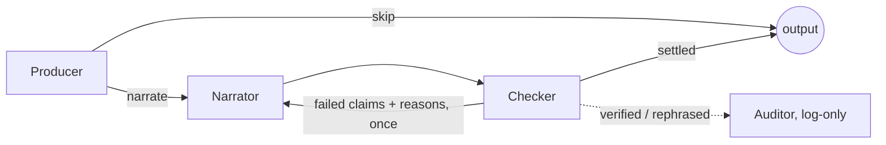

# Matchproof — Architecture

Python computes, agents orchestrate and narrate, the browser renders. The contract everything depends on is the **claim graph**: claim → fact → source IDs, with a verdict on every claim.

## Pipeline

```
Tactics / brief ──► Composer ──► MatchBrief
                                    │
                                    ▼
                         Generator (seeded, Python)
                    events + 5 Hz positions + freeze frames
                                    │ SSE stream at 1× / 3× / 6×
                                    ▼
                 Extractors + beat detector (incremental, Python)
                        facts with source IDs, candidate beats
                                    │
                                    ▼
                    Producer ──► Narrator ──► Checker ──┐
                                    ▲          (retry once) │
                                    └───────────────────────┘
                                    │ verdicts          └──► Auditor (log-only, second vendor)
                                    ▼
                         Localizer (modes, EN/ES)
                                    │
                                    ▼
                    Claim graph + overlay JSON ──► Live desk
```

All agents read and write one match store through the `match-data` MCP server. They never pass data to each other directly, which makes every handoff and retry traceable.

## Components

| Component | Kind | Input | Output |
| --- | --- | --- | --- |
| Composer | Agent (`gpt-5-mini`; code validates, the model only proposes) | Free-text brief | `{brief, brief_text, warnings}`: per-team formation and dials plus a preset storyline or custom planted moments. `sim.brief.validate_planted` and the schema check the answer; on errors it retries once with them, then keeps the valid part and warns. `brief_text` is the template, never model prose |
| Generator | Python | `MatchBrief` | `Event[]`, `PositionFrame[]` at 5 Hz, freeze frame per event |
| Extractors | Python | Events, frames | `Fact[]`, each with `source_ids` |
| Beat detector | Python | Facts, events | Candidate `Beat[]`, marked planted or detected |
| Producer | Agent (hard rules in code, model judges inside them) | One beat, its salience, a line on the beats already narrated | `{narrate, priority, note}` per beat and a `rank` on the narrated ones; at most 12 chosen by judgement a match |
| Narrator | Agent | One beat's fact bundle | Draft `Claim[]` with `fact_ids` |
| Checker | Python reconciler and voice lint, then an LLM judge (gpt-5-mini with a separate judge prompt, chosen by the bake-off below; the Claude judge is blocked, see ADR 0002) | Draft claims, facts | Verdict per claim; one retry to Narrator with reasons |
| Auditor | Agent (`judge-grok`, a second vendor), log-only | A claim the Checker settled as `verified` or `rephrased`, its facts | `audit` on the claim: `agree`, `disagree` (problem and reason) or `unavailable`; never changes the verdict |
| Localizer | Agent + Azure AI Translator | Verified claims | Fan, analyst and producer renderings; EN and ES; number invariance check |
| Renderer | Python | Beat, events, frames | `Overlay` JSON, timed to the match clock |
| match-data MCP | MCP server | Tool calls | Facts, events, freeze frames, beats and claims (see Match-data MCP) |

### Agent workflow

The agents are a Microsoft Agent Framework workflow (`packages/agents/src/agents/workflow.py`). One beat is one run of the graph; the Checker to Narrator edge is the only loop and is taken at most once per claim. The Checker's steps are the ones `Checker.check_beat` uses, so the verdicts are the same.



- **Producer.** Hard rules are code (`producer.py`): goals, red cards and follow-up `momentum_swing` beats are always narrated; `NARRATION_BUDGET = 12` beats chosen by judgement; no two narrated beats of one kind within 3 match minutes, except goals. Beats that are always narrated are not held back by the budget or the spacing. The model sees only the beat, its salience and a one-line summary of what was narrated, and judges salience, variety and whether the beat adds anything. Its `note` follows `docs/VOICE.md` and is linted; a note that breaks a rule is replaced. Decisions are made one at a time in the order beats were found, so ranks run 1 to n with no gaps.
- **Tools.** The agents reach match data only through the internal MCP server: `get_beat_bundle`, `get_brief`, `put_claims`, `put_audit`. No agent imports the store or the fact registry (a test asserts it). The server is reached in process over a memory transport and is never exposed on a network.
- **Auditor.** After the Checker settles a claim as `verified` or `rephrased`, `judge-grok` runs the same rubric (`judge.v2.md`) on its own pool of 2, with a 45 s timeout and one retry on a 429 or a timeout. The result is stored on the claim through `put_audit` and sent to the screen only as a `verdict` message carrying the same verdict plus `audit`. A disagreement goes to the Producer log (one plain line), the trace (an `audit` span linked to the beat's span) and `GET /matches/{match_id}/audit`. It does not change a published verdict in this version.
- **Cost guard.** `DAILY_TOKEN_CAP` (default 2,000,000) counts every model call by agent. At 90% of the cap auditing stops; at the cap new beats stream without narration and a `notice` status says narration is paused. `GET /health/budget` shows usage by agent, tokens in and out by agent, and the cost when `packages/agents/config/prices.yaml` is filled in ("prices not set" until then).
- **Tracing.** One OpenTelemetry trace per match run, a child span per beat workflow (`beat`), and spans for `producer`, `narrate`, `check` (with `reconcile`, `lint` and `judge`, the judge span holding the `chat <deployment>` span and its token usage), `retry` and `put_claims`. Every model call of a match is a `chat <deployment>` span with `gen_ai.usage.*` attributes. `claim.checker.trace_id` holds the trace id; `claim` and `verdict` messages carry the beat's span id.

### Checker order and judge bake-off

Per claim: the reconciler matches every number to a cited fact's display rendering, and a comparison word (the list is data in `voice/comparatives.yaml`: tighter, deeper, more, level, edge in front, take the lead) must be backed by a cited `before`, `change`, `score_after` or `lead` fact, or the claim fails with the word named; the voice lint runs, and only a claim that passes both reaches the judge. The judge sees the claim and its cited facts only and answers `supported`, `problem` and `reason`. Any failure sends the beat's failed claims back to the Narrator once with the reasons; a pass after that is `rephrased`, a second failure is `blocked`, and a judge that does not answer within 6 s leaves the claim `delayed`.

The judge was chosen by measurement (`make bakeoff`, 2026-10-22, judge prompt v2): 38 bad and 14 good claims in `evals/adversarial/claims.yaml`. Rule, applied in `evals/pick.py`: at least 35 of 38 caught, at most 1 of 14 good blocked, judge p90 at most 4 s; highest catch count wins, then lower p90. `judge.v2.md` allows verbs that describe the action and requires a fact for team state, motive, cause, comparison and uncovered periods.

| Judge | Bad caught (of 38) | by code | by judge | Good blocked (of 14) | Judge unavailable | p50 | p90 | Tokens per claim |
| --- | --- | --- | --- | --- | --- | --- | --- | --- |
| judge-mai (MAI-Thinking-1) | 32 | 14 | 18 | 0 | 11 | 19.3 s | 25.3 s | 1634 |
| judge-grok (grok-4.7) | 38 | 14 | 24 | 0 | 1 | 7.8 s | 22.6 s | 959 |
| gpt-5-mini (fallback) | 37 | 14 | 23 | 0 | 0 | 1.3 s | 1.7 s | 950 |

Neither candidate met the p90 limit, so the fallback judge is active. Full report: `evals/reports/bakeoff.md`.

## Tactics and the brief

The Tactics object inside `MatchBrief` (formation and press, directness and line height per team, plus a storyline) is the canonical generator input. Same tactics and seed produce the same match.

- Tactics → brief: deterministic template, in code.
- Brief → tactics: the Composer agent returns structured tactics; the UI shows them for the user to confirm or adjust. Nothing it returns reaches the generator without passing the validator a hand-written brief passes (`POST /matches` runs the same one and answers 422 with its messages).
- Randomize: `random_brief(seed)` picks random formations and dials, then a preset storyline or 1–3 random valid custom moments; the same seed gives the same brief (`POST /matches/random`). The template writes the brief text.
- Custom moments: storyline id `custom` plus up to 6 planted moments. Rules (`validate_planted`): windows inside 0–95′ with `minute_from` before `minute_to`; at most one red card per side; a penalty counts as a goal; goals for one side have windows at least 2 minutes apart. Three more keep a moment inside its window, which the generator cannot promise otherwise: a window stays within one half, `open_play_goal` and `penalty` windows are at least 2 minutes wide, and no two windows overlap. The final score is the planted goals; nothing else scores. The storyline text is a template ("Custom: Ashford Vale red card 30–35′; Rivermouth goal 70–80′").

## Live mode

- The API streams the generator's output over Server-Sent Events: `event`, `frame` (5 Hz), `fact`, `beat`, `claim` and `verdict` messages.
- Extractors run incrementally per event. The beat detector fires when a pattern completes.
- Each beat is handed to the agent workflow the moment the detector finds it, on a pool of 3 (`MAX_CONCURRENT_BEATS`). The Producer decides whether it is narrated; the Narrator and Checker follow.
- **Verify before air.** The pipeline runs 120 match seconds ahead of playback, and playback slows to 1 match second per second inside the window before a beat, so a beat's claims are usually narrated and checked before the viewer reaches the moment, like a broadcast delay. When playback reaches the beat the stream sends its facts, the beat (with its `rank`), then its claims: a claim whose check has finished goes out as a `claim` with its final verdict and `checker.latency_ms`; a claim still being checked goes out as `checking` and gets a `verdict` message the moment the Checker finishes. Nothing is delayed to make this look better, and a verdict is never sent before the check ended. A beat the Producer skipped is still streamed, with no claims.
- Messages count in the order they are sent, so a stream with agent messages is not reproducible from the brief alone. A reconnect reuses the match's settled claims and does not call the models again, but `Last-Event-ID` resumes the numbering only approximately; the UI keeps claims by id.
- Budget: 8 s per beat at p90 from detection to verdict.
- Degrade, don't fail: a model error or timeout leaves the claim `delayed` and the match keeps playing. A tripped token cap streams beats without narration and sends a `notice` status ("Narration is paused for today."). If the workflow is down, beats stream without claims and a `notice` says verification is unavailable. If the API is unreachable, the site offers the cached replay.

## Match-data MCP

`packages/mcp_match` is the agents' only door to match data (ADR 0008). `build_server(store, writable)` defines the tools once and adds `put_claims` and `put_audit` only when `writable` is true.

- **Public, read-only:** `/mcp` on the API, streamable HTTP, 60 requests per minute per client address, no write tool and no key.
- **Internal, read-write:** `get_internal_server(store)` in `services/api/src/api/matchdata.py`, used in process by the agent workflow and never routed.

| Tool | Returns | Public | Internal |
| --- | --- | --- | --- |
| `get_brief(match_id)` | The match brief | yes | yes |
| `get_fact(match_id, fact_id)` | One fact in full, with display renderings and sources | yes | yes |
| `find_facts(match_id, name_prefix, side, t_from, t_to, limit)` | Facts in id order, at most 200, with the matching `total` | yes | yes |
| `get_events(match_id, t_from, t_to, types, limit)` | Events in a time range, at most 200, with `total` | yes | yes |
| `get_freeze_frame(match_id, event_id)` | Player ids, sides and positions rounded to 0.1 m, plus the ball | yes | yes |
| `list_beats(match_id, after_t)` | Beats detected so far | yes | yes |
| `get_beat_bundle(match_id, beat_id)` | A beat and every fact it cites; this is what the Narrator reads. A beat anchored on a goal (the goal, or the spell after it) also carries `score_after` and `lead` | yes | yes |
| `put_claims(match_id, beat_id, claims)` | Per-claim `accepted` and `errors`; each claim is checked against `claim.schema.json`, the beat and the fact ids it cites | no | yes |
| `put_audit(match_id, claim_id, audit)` | Attaches the auditor's result to a stored claim; the verdict is untouched | no | yes |

Unknown match, fact, beat and event ids return a tool error. A running match is registered in the store when its stream starts and filled in as the pipeline advances; the pipeline writes a batch only once it is within the 120 s lookahead of playback, so a query never sees further ahead than that. The store keeps six matches and drops the least recently used.

## Match storage

A match is archived at full time, in a background task, so the stream is not delayed. The save waits up to 60 s for audits still running, then writes `<match_id>/` through a `MatchArchive` (`mcp_match/persist.py`): `FileArchive` under `data/archive/` locally (the default; `MATCH_ARCHIVE_DIR` moves it), or `BlobArchive` on the `matches` container (`MATCH_ARCHIVE=blob`, account from `AZURE_STORAGE_ACCOUNT`, `DefaultAzureCredential`; the API's managed identity holds Storage Blob Data Contributor on that container). An archived match is not saved again.

| File | Holds |
| --- | --- |
| `brief.json` | The `MatchBrief` |
| `events.jsonl.gz` | Every event |
| `facts.jsonl.gz` | The fact registry; the first line is `{"aggregates": {...}}` |
| `beats.jsonl` | The detected beats |
| `claim_graph.json` | A `ClaimGraph` (`claim_graph.schema.json`): facts, beats, claims with their audits, final score |
| `audit.json` | The auditor's summary, as `GET /matches/{id}/audit` serves it |
| `producer_log.json` | The Producer's decisions, as `GET /matches/{id}/producer-log` serves them |
| `usage.json` | Tokens per role and model for this match, and cost if `prices.yaml` is set |
| `frames.jsonl.gz` | Position frames at 5 Hz (regenerated from the brief and events at save time) |
| `freeze.jsonl.gz` | One `{event_id, frame}` per freeze frame |
| `manifest.json` | Written last: files and sizes, schema versions, git SHA (`GIT_SHA`), created time, storyline, final score, claim counts |

The manifest is the commit marker. A match without one is a save that did not finish; it is not listed and not loaded. A match that is not in memory is loaded from the archive when the store, MCP, fact lookup, `/audit` or `/producer-log` asks for it; least-recently-used eviction applies to memory only. `GET /matches` lists archived matches from their manifests, newest first.

## Player positions

- Contract: `PositionFrame` at 5 Hz for 22 players plus the ball, and a freeze frame attached to every event.
- Version 1 (Tue Oct 20): formation shape model. Each player has a slot; the shape shifts with the ball and the team's line-height dial.
- Version 2 (Mon Oct 26, committed): role-based movement. Hold slot, press when nearest (scaled by press dial), make runs in possession (scaled by directness), track runners. Speed and acceleration caps. The passer, receiver and shooter are pinned to each event's location so frames and events never disagree.
- Positional claims (for example "players ahead of the ball") are computed from freeze frames and checked like any other fact.

## Azure services

| Stage | Service | Why |
| --- | --- | --- |
| Models and agents | Microsoft Foundry (project, model deployment, Agent Service, tracing) | Hero technology; prompts, evals and traces in one place |
| Orchestration | Microsoft Agent Framework (Python) | Sequential workflow with a Checker → Narrator loop |
| API and MCP server | Azure Container Apps | Scales to zero; serves SSE and MCP |
| Storage | Azure Blob Storage | Match store and cached claim graphs |
| Languages | Azure AI Translator | Deterministic translation of already-verified text |
| Front end | Azure Static Web Apps at matchproof.tylermartins.com | No login; custom domain with managed TLS |
| Observability | Application Insights (OpenTelemetry) | One trace per run, linked from Producer mode |
| Identity and secrets | Managed identity, Key Vault | No keys in code or config |
| Audit (stretch) | Microsoft Fabric lakehouse | Every claim and verdict, queryable |

## Contracts

Schemas live in `schemas/`. Python models and TypeScript types are generated from them.

| Schema | Holds |
| --- | --- |
| `match_brief` | Seed, tactics for both teams, storyline, planted beats |
| `event` | One match event, absolute 120 × 80 coordinates |
| `position_frame` | 22 players + ball at one instant |
| `fact` | One computed value with its source IDs and the extractor that produced it |
| `beat` | One key moment, planted or detected, with its fact IDs |
| `claim` | One sentence, its fact IDs, verdict, draft and reason |
| `overlay` | Timed drawing instructions for one beat |
| `claim_graph` | Everything above for one match, as served to the desk |

## Themes

Two themes from one token file: **Broadcast** (dark, condensed display type, made for overlays on footage) and **Editorial** (cream, Fraunces and Geist, crimson and navy). Components read tokens only; no hard-coded colours.
